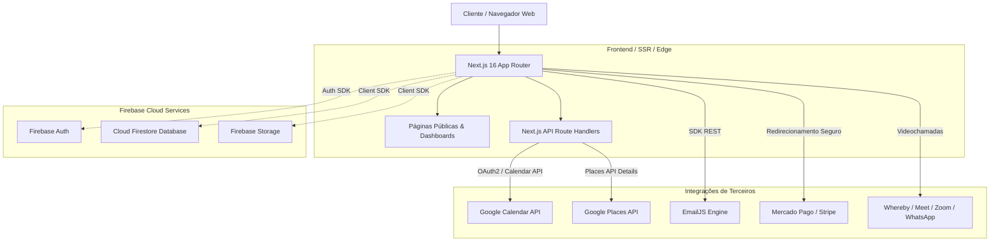
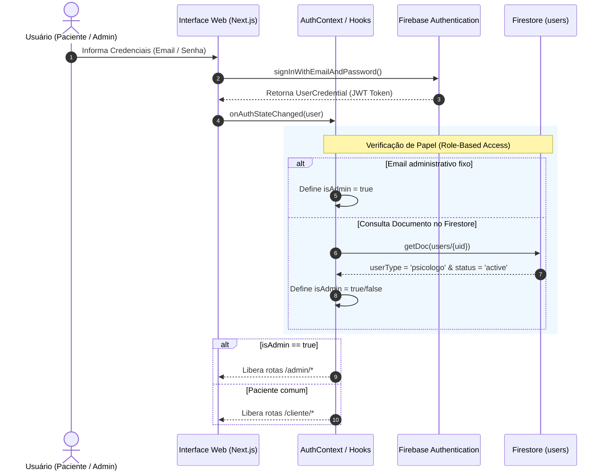
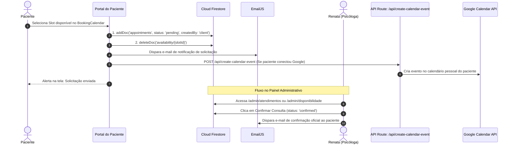
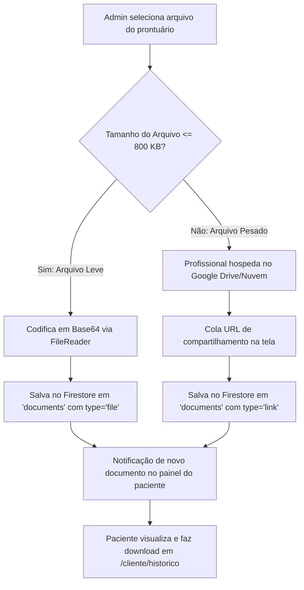
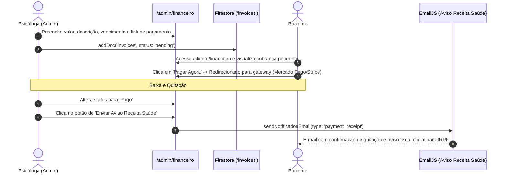

# 📚 Documentação Técnica e Processos Ponta a Ponta
## Plataforma Renata Ribeiro — Psicologia & Neuropsicopedagogia

---

## 1. Visão Geral do Sistema

A **Plataforma Renata Ribeiro** é uma solução web integrada (SaaS-like) voltada para a gestão clínica e atendimento digital humanizado em Psicologia e Neuropsicopedagogia.

O ecossistema unifica:
1. **Portal Institucional de Alta Conversão:** Apresentação de serviços, prova social sincronizada com Google Reviews em tempo real, captação de clientes e compliance com a LGPD.
2. **Área Exclusiva do Paciente:** Agendamento self-service, sala de teleterapia, prontuário digital com download de laudos/exercícios, canal de chat direto e gestão de cobranças.
3. **Painel de Controle Administrativo (Profissional):** Gestão de agenda com sincronização bidirecional no Google Calendar, prontuário eletrônico unificado, faturamento com aviso do Receita Saúde (conformidade fiscal IRPF), hub de teleconferência e publicação de conteúdos exclusivos.

---

## 2. Arquitetura de Software e Tecnologias

A aplicação foi estruturada segundo o paradigma de **Arquitetura Serverless Jamstack**, priorizando baixa latência, alta segurança e facilidade operacional.



### Stack Tecnológica
* **Frontend Framework:** Next.js 16 (App Router, Server & Client Components)
* **Biblioteca Base:** React 19, TypeScript 5
* **Estilização:** CSS Modules dedicados e responsivos com variáveis em `globals.css`
* **Ícones:** Lucide React & React Icons
* **Banco de Dados & Autenticação:** Firebase Auth, Cloud Firestore (NoSQL em tempo real) e Firebase Storage
* **Disparo Transacional de E-mails:** EmailJS
* **Sincronização de Calendário:** Google APIs Client (`googleapis` v164) com fluxo de autorização OAuth2 offline
* **Prova Social:** Google Places API com camada de cache em memória
* **SEO & Indexação:** `next-sitemap` integrado ao ciclo de pós-build
* **Hospedagem & CI/CD:** Vercel

---

## 3. Modelo de Dados (Cloud Firestore)

O banco de dados é modelado no Cloud Firestore em coleções independentes com controle de acesso rigoroso por documento.

### 3.1. Coleção `users`
Armazena o perfil dos usuários autenticados (psicólogo e pacientes).
```typescript
interface UserDocument {
  uid: string;
  name: string;
  displayName?: string;
  email: string;
  userType: 'paciente' | 'psicologo';
  status: 'active' | 'inactive';
  googleRefreshToken?: string; // Token OAuth2 para escrita na agenda
  createdAt: Timestamp;
}
```

### 3.2. Coleção `appointments`
Representa os agendamentos de consultas terapêuticas.
```typescript
interface AppointmentDocument {
  id: string;
  patientId: string;
  patientName: string;
  psychologistId: string;
  title: string;
  date: Timestamp;
  start: Timestamp;
  end: Timestamp;
  status: 'pending' | 'confirmed' | 'cancelled' | 'completed';
  createdBy: 'client' | 'admin';
  createdAt: Timestamp;
  notes?: string;
}
```

### 3.3. Coleção `availability`
Slots de horários abertos criados pelo administrador para agendamento.
```typescript
interface AvailabilityDocument {
  id: string;
  start: Timestamp;
  end: Timestamp;
  psychologistId: string;
  title: string;
}
```

### 3.4. Coleção `documents` (Prontuário Digital)
Armazenamento híbrido de laudos, avaliações neuropsicológicas e atividades.
```typescript
interface DocumentRecord {
  id: string;
  patientId: string;
  fileName: string;
  type: 'file' | 'link';
  fileData?: string;      // Base64 embutido para arquivos <= 800 KB
  externalLink?: string;  // Link do Google Drive / OneDrive para arquivos pesados
  read: boolean;
  uploadedAt: Timestamp;
}
```

### 3.5. Coleção `invoices` (Financeiro)
Controle de faturamento, cobranças e conformidade fiscal.
```typescript
interface InvoiceRecord {
  id: string;
  patientId: string;
  patientName: string;
  description: string;
  amount: number;
  status: 'pending' | 'paid' | 'overdue';
  dueDate: Timestamp;
  paymentLink?: string;  // URL do checkout (Stripe, Mercado Pago)
  date: Timestamp;
}
```

### 3.6. Coleção `chats` e Subcoleção `messages`
Comunicação criptografada e direta entre o paciente e a profissional.
```typescript
// Caminho: chats/{patientId}
interface ChatRoom {
  id: string; // Equivalente ao patientId
  patientId: string;
  patientName: string;
  lastMessage: string;
  lastUpdated: Timestamp;
  unreadCount: number;
}

// Caminho: chats/{patientId}/messages/{messageId}
interface ChatMessage {
  id: string;
  senderId: string; // 'admin' ou patientId
  text: string;
  fileUrl?: string;
  fileName?: string;
  fileType?: string;
  read: boolean;
  createdAt: Timestamp;
}
```

### 3.7. Coleção `contents`
Artigos, vídeos educativos e materiais didáticos compartilhados.
```typescript
interface ContentRecord {
  id: string;
  title: string;
  type: 'Artigo' | 'Vídeo' | 'PDF' | 'Link';
  description: string;
  url: string;
  locked: boolean; // Se restrito a pacientes com login
  createdAt: Timestamp;
}
```

---

## 4. Matriz de Segurança e Regras do Firestore (`firestore.rules`)

O Firestore opera com isolamento rigoroso por perfil:
* **Admin (Psicólogo):** Reconhecido pelo atributo `userType == 'psicologo'` ou pelo e-mail institucional `renataribeiro.neuropsico@gmail.com`.
* **Paciente:** Possui acesso estritamente restrito aos seus próprios registros (`request.auth.uid == resource.data.patientId`).

| Recurso / Coleção | Leitura (Paciente) | Escrita (Paciente) | Leitura (Admin) | Escrita (Admin) |
| :--- | :--- | :--- | :--- | :--- |
| `users` | Apenas próprio registro | Apenas próprio registro | Todos os pacientes | Próprio registro |
| `availability` | Usuários autenticados | Proibido | Permitido | Criação / Exclusão |
| `appointments` | Próprias consultas | Solicitar / Cancelar | Todas | Total |
| `documents` | Apenas seus laudos | Proibido | Todos | Criação / Exclusão |
| `invoices` | Suas próprias faturas | Proibido | Todas | Total |
| `chats/{id}/messages` | Apenas sua sala | Enviar na sua sala | Todas as salas | Responder a todos |
| `contents` | Autenticados | Proibido | Permitido | Total |

---

## 5. Processos Ponta a Ponta

### 5.1. Processo de Autenticação e Controle de Acesso (RBAC)



---

### 5.2. Processo de Agendamento de Consultas & Google Calendar

Este processo conecta a solicitação do paciente à confirmação da terapeuta e à sincronização da agenda externa:



---

### 5.3. Processo de Gestão de Prontuário e Documentos (Arquitetura Híbrida)

Para conciliar desempenho, custos e compatibilidade, o sistema adota um pipeline duplo de documentos:



---

### 5.4. Processo Financeiro e Conformidade "Receita Saúde"



> **Nota de Compliance Fiscal:** Em conformidade com a regulamentação para profissionais autônomos de saúde, o e-mail transacional informa formalmente ao paciente que o recibo eletrônico oficial para dedução do Imposto de Renda de Pessoa Física (IRPF) é emitido diretamente no sistema **Receita Saúde** da Receita Federal.

---

### 5.5. Processo de Teleterapia (Hub Unificado)

A plataforma disponibiliza um **Hub Conectivo** que elimina atritos técnicos no momento da consulta online:
1. **Whereby (Sala Fixa):** URL padronizada com passagem automática do nome do paciente codificado na query string (`?displayName=NomeDoPaciente`).
2. **Google Meet:** Acesso direto à interface para criação ou entrada de salas corporativas.
3. **Zoom:** Integração com deep link para inicialização de reunião.
4. **WhatsApp Web:** Canal de contingência imediata com início rápido de videochamada móvel ou no navegador.

---

### 5.6. Processo de Chat Seguro e Tempo Real

* **Listener Bidirecional:** Tanto o paciente quanto a profissional escutam a subcoleção `chats/{patientId}/messages` via `onSnapshot` do Firestore com atualização em milissegundos.
* **Badge de Notificações:** O hook customizado `useDashboardNotifications` realiza queries reativas para exibir o contador de mensagens não lidas nos cards do dashboard.
* **Confirmação de Leitura:** Assim que a janela da conversa é aberta pelo destinatário, um batch update marca `read: true`, alterando o ícone para check duplo azul (`CheckCheck`).

---

### 5.7. Processo de Avaliações (Google Places API com Cache)

* **Endpoint:** `/api/google-reviews`
* **Identificador:** Place ID `ChIJZT_hSMz5zoQROZz0H1YgP0Y`
* **Estratégia de Cache:** Para otimizar a cota gratuita do Google Cloud, a rota implementa cache em memória com TTL de 24 horas (`CACHE_TTL_MS = 86400000`).
* **Fallback Gratuito:** Caso a variável `GOOGLE_PLACES_API_KEY` não esteja presente no ambiente de testes, o serviço retorna depoimentos estáticos homologados, garantindo que a aplicação nunca apresente falhas visuais.

---

## 6. Variáveis de Ambiente e Configuração

Para executar a aplicação em desenvolvimento ou produção, crie o arquivo `.env.local`:

```env
# ==========================================
# FIREBASE WEB CONFIGURATION
# ==========================================
NEXT_PUBLIC_FIREBASE_API_KEY="AIzaSy..."
NEXT_PUBLIC_FIREBASE_AUTH_DOMAIN="seu-projeto.firebaseapp.com"
NEXT_PUBLIC_FIREBASE_PROJECT_ID="seu-projeto-id"
NEXT_PUBLIC_FIREBASE_STORAGE_BUCKET="seu-projeto.appspot.com"
NEXT_PUBLIC_FIREBASE_MESSAGING_SENDER_ID="123456789012"
NEXT_PUBLIC_FIREBASE_APP_ID="1:123456789012:web:abcdef"
NEXT_PUBLIC_FIREBASE_MEASUREMENT_ID="G-XXXXXXXXXX"

# ==========================================
# EMAILJS (NOTIFICAÇÕES TRANSACIONAIS)
# ==========================================
NEXT_PUBLIC_EMAILJS_SERVICE_ID="service_xxxxxxx"
NEXT_PUBLIC_EMAILJS_TEMPLATE_ID="template_padrao"
NEXT_PUBLIC_EMAILJS_TEMPLATE_CONFIRMACAO="template_confirmacao"
NEXT_PUBLIC_EMAILJS_TEMPLATE_RECIBO="template_recibo_saude"
NEXT_PUBLIC_EMAILJS_PUBLIC_KEY="public_key_xxxxxxx"

# ==========================================
# GOOGLE APIS & CALENDAR OAUTH2
# ==========================================
GOOGLE_CLIENT_ID="xxxxxxx-xxxxxxx.apps.googleusercontent.com"
GOOGLE_CLIENT_SECRET="GOCSPX-xxxxxxxxxxxxxx"
GOOGLE_REDIRECT_URI="https://seu-dominio.com/api/auth/google/callback"
# Em ambiente local: http://localhost:3000/api/auth/google/callback

# ==========================================
# GOOGLE PLACES API (AVALIAÇÕES & PROVA SOCIAL)
# ==========================================
GOOGLE_PLACES_API_KEY="AIzaSy..."
```

---

## 7. Configuração de CORS no Firebase Storage

Caso venha a reativar uploads diretos via browser no Storage:
1. Instale o Google Cloud SDK ou acesse o Google Cloud Shell.
2. Aplique a configuração presente em [cors.json](file:///c:/Users/Daniel/OneDrive/Documentos/Daniel/Projetos/renata-ribeiro-neuropsico/cors.json):
```bash
gsutil cors set cors.json gs://SEU_BUCKET.appspot.com
```

---

## 8. Ciclo de Vida do Desenvolvimento e Deploy

### 8.1. Scripts Disponíveis no `package.json`
* `npm run dev`: Inicializa o servidor local Next.js em `http://localhost:3000`.
* `npm run build`: Compila a aplicação otimizada para produção.
* `npm run postbuild`: Executa automaticamente o `next-sitemap` para gerar `sitemap.xml` e `robots.txt`.
* `npm run start`: Executa o bundle de produção compilado.
* `npm run lint`: Executa validação de regras de linting via ESLint 9.

### 8.2. Pipeline de Deploy Contínuo (Vercel)
1. **Push na branch principal (`main`):** Dispara a esteira automatizada da Vercel.
2. **Build Step:** Instalação das dependências com `npm ci`, compilação dos Server Components e geração das páginas estáticas.
3. **Post-build:** Indexação automática do mapa do site para motores de busca (Google, Bing).
4. **Deploy Edge/Serverless:** Publicação instantânea com certificado SSL ativo e CDN global.

---

## 9. Procedimentos Operacionais e Troubleshooting

1. **Paciente não visualiza consulta no painel:**
   * Verifique se o `patientId` gravado em `appointments` coincide exatamente com o `uid` do usuário em `users`.
2. **Falha ao criar evento no Google Calendar:**
   * O usuário deve primeiro clicar em "Vincular com Google Agenda" para conceder permissão offline (`googleRefreshToken`).
   * Verifique se as credenciais `GOOGLE_CLIENT_ID`, `GOOGLE_CLIENT_SECRET` e a URL de redirecionamento autorizada batem com o console do Google Cloud.
3. **E-mails não estão chegando:**
   * Verifique a cota mensal da conta no painel do EmailJS e garanta que as chaves `NEXT_PUBLIC_EMAILJS_*` estão configuradas na Vercel em *Environment Variables*.
